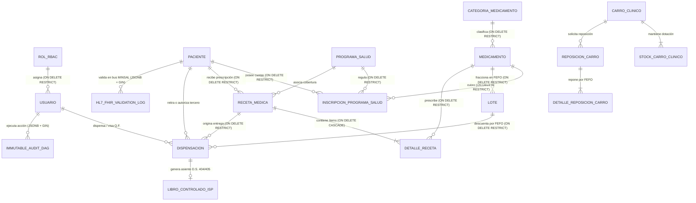

# Arquitectura de Datos Híbrida (SQL Relacional + No Estructurado JSONB/GIN)
## Sistema Web de Gestión para Farmacia Asistencial (CESFAM)

Documento técnico de respaldo para los criterios de evaluación:
- **Criterio 2.1.4.8 (10 puntos - Destacado):** *Define entidades y relaciones de manera óptima; incluye integridad referencial y claves primarias/secundarias.*
- **Criterio 2.1.4.9 (5 puntos - Destacado):** *Implementa bases estructuradas y no estructuradas con ejemplos funcionales.*

---

## 1. Cumplimiento de Exclusiones del Sector Público (Salud Primaria APS)

En estricta conformidad con el alcance de la Farmacia Asistencial CESFAM (Sección 2.5 de la Evaluación 1 y Sección 7 de `Requerimientos_detallados.pdf`), el modelo de datos **excluye por completo**:
- Ventas comerciales, carritos de compra, precios unitarios, IVA o descuentos comerciales.
- Puntos de Venta (POS), aperturas/cierres de caja o medios de pago.
- Emisión de Documentos Tributarios Electrónicos (boletas o facturas).
- Convenios con Isapres o seguros privados complementarios (solo opera con afiliación pública **FONASA Tramos A, B, C y D**).
- Rol "Vendedor" (restringido estrictamente a los 4 perfiles institucionales: `ADMIN` Administrador, `QF` Químico Farmacéutico, `TECNICO` Técnico en Farmacia y `CLINICO` Personal Clínico).

---

## 2. Diagrama Entidad-Relación Óptimo (Criterio 2.1.4.8)

---

## 3. Justificación de la Base de Datos Híbrida (Criterio 2.1.4.9)

### 3.1. Componente Estructurado (SQL Relacional en PostgreSQL)
Garantiza atomicidad transaccional (`ACID`), integridad referencial estricta (`ON DELETE PROTECT/RESTRICT`) y validaciones de dominio (`CheckConstraint`, `UniqueConstraint`, y validador **Módulo 11** de RUT chileno) sobre las operaciones críticas de inventario (`stock_bodega`, `stock_vitrina`), selección **FEFO**, cuotas **GES/AUGE y Crónicos**, **Recetas Retenidas** y **Carros Clínicos**.

### 3.2. Componente No Estructurado (Documental `JSONB` con Índices `GIN` en PostgreSQL)

1. **`ImmutableAuditDAG` (`immutable_audit_dag`)**:
   - **Propósito Normativo:** Cumplir la norma **ALCOA+** (*Atribuible, Legible, Contemporánea, Original, Exacta*) del Instituto de Salud Pública (ISP).
   - **Estructura Documental:** Almacena en `payload_json` (`JSONB`) el snapshot completo previo y posterior de cada dispensación, bloqueo de lote o reposición de carro clínico.
   - **Inmutabilidad Criptográfica (DAG):** Cada nodo calcula su `current_hash` mediante **SHA-256** incorporando el `previous_hash` del nodo anterior, bloqueando cualquier intento de `UPDATE` o `DELETE` tanto en el ORM de Django como mediante el trigger `trg_immutable_audit_dag_append_only` en PostgreSQL.
   - **Indexación GIN:** `CREATE INDEX idx_audit_dag_payload_gin ON immutable_audit_dag USING GIN (payload_json jsonb_path_ops);`

2. **`HL7FHIRValidationLog` (`hl7_fhir_validation_log`)**:
   - **Propósito de Interoperabilidad:** Almacenar de forma nativa los recursos clínicos jerárquicos del estándar **HL7 FHIR Release 4 (Perfil Core Chile - MINSAL / FONASA)**:
     - `patient_resource` (`JSONB`): Recurso FHIR `Patient` con identificador oficial RUN (`urn:oid:2.16.152.1.2.1.1`).
     - `coverage_resource` (`JSONB`): Recurso FHIR `Coverage` validando tramo **FONASA (A, B, C, D)** y gratuidad Copago Cero APS.
     - `medication_request_resource` (`JSONB`): Recurso FHIR `MedicationRequest` con prescripción y posología.
   - **Indexación GIN:** Índices `idx_fhir_patient_gin`, `idx_fhir_coverage_gin` e `idx_fhir_medreq_gin` para consultas documentales de sub-milisegundos mediante operadores `@>` y `jsonb_path_query`.
